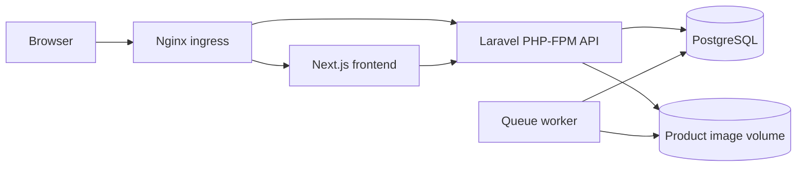
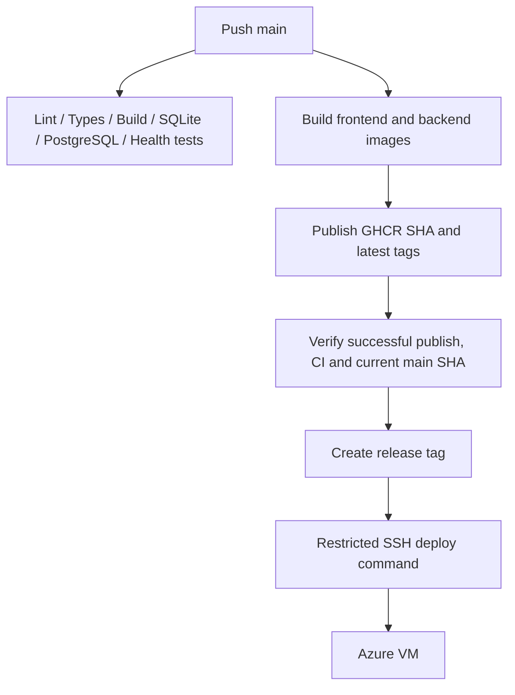

# System Architecture และ CI/CD บน Azure

Frontend ส่งคำขอ API ผ่าน `/api`; Server-side ใช้ `INTERNAL_API_URL` ตาม environment. Nginx ส่งหน้าเว็บไป Next.js และส่ง API ให้ Laravel. Backend ตรวจ token, role และเจ้าของข้อมูลก่อนทำงาน; ฐานข้อมูลเก็บสินค้า ตะกร้า คำสั่งซื้อและการชำระเงิน ส่วนภาพสินค้าแยกใน volume

[production.conf](../docker/nginx/production.conf) และ [compose.prod.yml](../compose.prod.yml) อธิบาย topology ที่อยู่ใน repository โดย Compose นี้เป็น **prod-test** ใช้ image ชื่อ local และ bind loopback port 8180 จึงไม่ควรอ้างว่าเป็นไฟล์ Azure runtime ที่ตรวจยืนยันแล้ว

Workflow `publish-images.yml` ทำงานเมื่อ frontend/backend หรือ workflow ที่กำหนดเปลี่ยน; `auto-release-deploy.yml` รอ publish สำเร็จ ตรวจ CI ของ SHA เดียวกันและตรวจ main ไม่เลื่อนไปก่อนสร้าง release. `deploy-production.yml` รองรับ release published และ manual dispatch. ทั้งสองทาง deploy ใช้ concurrency group เดียวกันและ SSH known-host verification

อ้างอิง [CI](../.github/workflows/ci.yml), [Publish](../.github/workflows/publish-images.yml), [Auto release](../.github/workflows/auto-release-deploy.yml), [Deploy](../.github/workflows/deploy-production.yml)

เว็บไซต์สาธิต: [panaprisin.me](https://panaprisin.me). การเปิดเว็บได้ไม่พิสูจน์ว่า runtime ใช้ SHA เดียวกับ main หรือ migrations ครบ; ครั้งนี้ไม่ได้ SSH ตรวจ image digest, schema หรือสคริปต์ deployment บน VM และไม่ได้ Deploy
