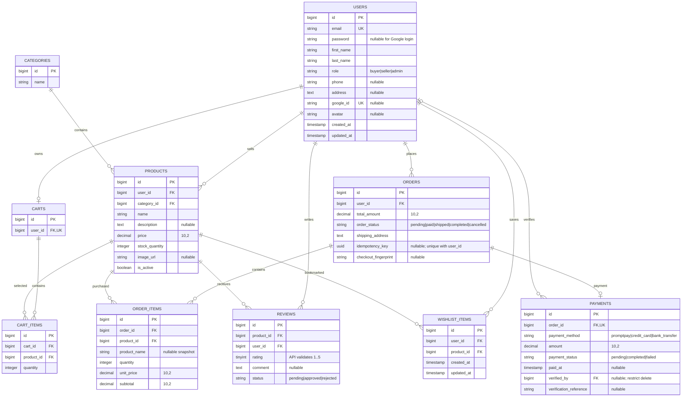

# ER / EER — schema หลัง migrations 31 ตุลาคม 2026

อ้างอิง `backend/database/migrations` โดยเพิ่มเพียง `2026_10_31_000001_create_wishlist_items_table` , `2026_10_31_000002_add_payment_verification_audit` และ additive `2026_10_31_000003_harden_cart_integrity_and_lookup_indexes`

ทุก commerce entity มี created_at/updated_at ตาม migration (ละบางฟิลด์ timestamp ใน diagram เพื่อให้อ่านง่าย) ตาราง infrastructure: personal_access_tokens (Sanctum polymorphic tokenable), sessions, password_reset_tokens, cache/cache_locks, jobs/job_batches/failed_jobs ไม่ได้เปลี่ยนในงานนี้

## Constraints และ EER

- User specialization ใช้ discriminator `users.role` แบบ total/disjoint: แต่ละ user เป็น buyer, seller หรือ admin หนึ่ง role ไม่มีตาราง subtype ซ้ำ
- Wishlist เป็น associative entity ของ User M:N Product; UNIQUE(user_id, product_id), FK ทั้งคู่ cascadeOnDelete; API รับ user_id จาก token เท่านั้น
- Review เป็น associative entity User M:N Product; UNIQUE(user_id, product_id) เดิม; rating 1–5 บังคับใน API ไม่อ้างว่ามี DB CHECK ใน migration เดิม; published query กรอง 1–5 และการซื้อจริงด้วย
- CartItem UNIQUE(cart_id, product_id) เพิ่มใน migration 000003 (preflight ปฏิเสธ legacy duplicates โดยไม่แก้แถว); Cart user_id unique; Payment order_id unique จึงเป็น 0..1 payment ต่อ order ที่ระดับ schema (checkout สร้างหนึ่งเสมอ)
- Order UNIQUE(user_id, idempotency_key) โดย key nullable สำหรับ legacy; OrderItem เก็บ snapshot ชื่อและราคา
- verified_by เป็น optional User FK ใช้กับ Admin ผู้ตรวจเงินจริง และ restrict delete; ไม่เปิด audit reference ให้ buyer/seller ผ่าน Payment serialization
- Commerce FK เดิมส่วนใหญ่ cascade delete; application จึง archive product และปฏิเสธลบ user ที่มี orders/products/reviews เพื่อรักษาประวัติ ไม่แก้ FK เดิมย้อนหลัง
- กฎ review buyer + completed purchase + completed payment/paid_at/amount และกฎเปลี่ยน order state เป็น application constraints ไม่ใช่ความสัมพันธ์ FK ไปยัง order ของรีวิวโดยตรง
- average_rating/reviews_count/revenue เป็น derived values คำนวณจากข้อมูลจริง ไม่เพิ่มตารางหรือคอลัมน์สะสมที่อาจไม่ตรงข้อมูล

## State และความหมายยอดขาย

pending → paid ผ่าน Admin confirm-payment เท่านั้น; paid → shipped → completed; pending → cancelled คืน stock ครั้งเดียวใน transaction โดยไม่เปลี่ยนราคา/ยอดเงินประวัติ

Sales ใช้ SUM(order_items.subtotal), COUNT(DISTINCT order_id) และ SUM(quantity) เมื่อ order paid/shipped/completed และ payment completed, paid_at ไม่ว่าง, amount=total_amount; date filter อ้างอิง paid_at วันไทย ไม่ใช่วันที่สร้าง order; seller filter ที่ product.user_id ซึ่ง API ไม่ให้เปลี่ยนเจ้าของสินค้า

## Indexes เพิ่มใน Quality Audit

- cart_items UNIQUE(cart_id, product_id): ป้องกันแถวซ้ำแม้มี writer นอก API
- orders(user_id, created_at): account history lookup
- reviews(product_id, status): published review lookup
- order_items(product_id, order_id): seller/product history lookup
- wishlist_items(product_id): FK lookup; UNIQUE(user_id, product_id) เดิมยังคงอยู่

ไม่มีการเพิ่มตารางหรือ subtype ใหม่ใน audit; OAuth ใช้ sessions เดิมและ Sanctum personal_access_tokens เดิม; payment verified_by/reference เดิมเปิดอ่านเฉพาะ Admin
