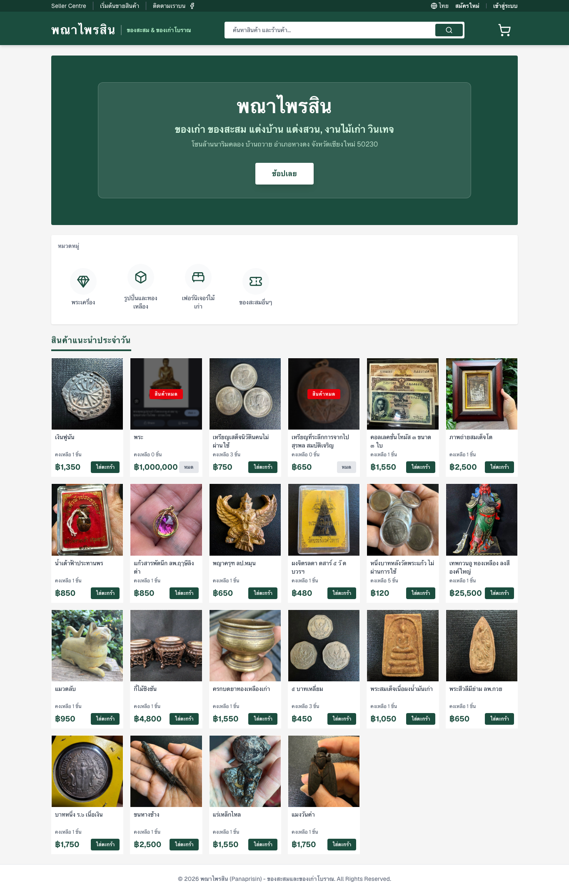

# ภาพรวมโครงงาน

Web_Panaprisin เป็นเว็บซื้อขายสินค้าที่แยกบทบาทผู้ซื้อ ผู้ขาย และผู้ดูแลระบบ เป้าหมายคือเชื่อมการเลือกสินค้า ตะกร้า คำสั่งซื้อ สต็อก การตรวจรับชำระเงิน และรายงานยอดขายเข้าด้วยกัน โดยบังคับสิทธิ์ที่ Backend

| บทบาท | ความสามารถ |
|---|---|
| ผู้เยี่ยมชม | ดูรายการและรายละเอียดสินค้า รีวิว สมัครสมาชิกและเข้าสู่ระบบ |
| Buyer | ตะกร้า Checkout ประวัติคำสั่งซื้อ โปรไฟล์ Wishlist และรีวิวหลังซื้อสำเร็จ |
| Seller | เพิ่ม แก้ไข เก็บสินค้าของร้าน ดูคำสั่งซื้อและรายงานยอดขายของร้าน |
| Admin | ภาพรวม ผู้ใช้ สินค้า คำสั่งซื้อ ตรวจรับชำระเงิน กลั่นกรองรีวิว และรายงานรวม |

| เทคโนโลยี | รุ่น/หน้าที่ตามไฟล์โครงการ |
|---|---|
| Next.js / React | 15.5.26 / 19.1.0, App Router |
| TypeScript / Tailwind CSS | ^5 / ^4 สำหรับชนิดข้อมูลและหน้าจอ responsive |
| PHP / Laravel | ^8.3 / ^13.17 ตาม composer.json |
| Sanctum / Socialite | ^4.3 / ^5.31 สำหรับ Bearer token และ Google OAuth |
| PostgreSQL | 17 Alpine ใน Compose |
| Nginx / Docker Compose | Reverse proxy, PHP-FPM และเครือข่ายบริการ |
| GitHub Actions / GHCR / Azure | ตรวจโค้ด สร้าง image และส่งระบบขึ้น VM |
| PHPUnit / Playwright | ทดสอบ API/ธุรกรรม และ Browser |

อ้างอิง [frontend/package.json](../frontend/package.json), [backend/composer.json](../backend/composer.json) และ [Compose](../compose.prod.yml) รุ่นใน manifest เป็นข้อกำหนด dependency ไม่ใช่การยืนยันรุ่นที่รันบน Azure

ระบบไม่มี Payment Gateway หรือ Webhook ยืนยันเงินอัตโนมัติ การเลือกวิธีชำระเงินไม่ได้หมายถึงชำระสำเร็จ และยังไม่มีระบบคืนเงินอัตโนมัติ

