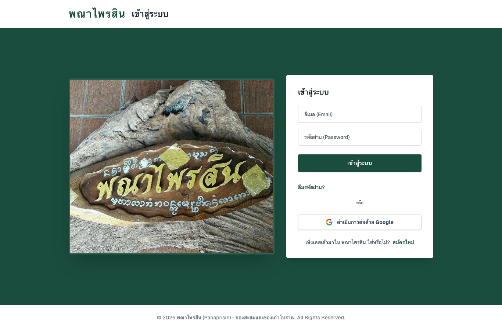
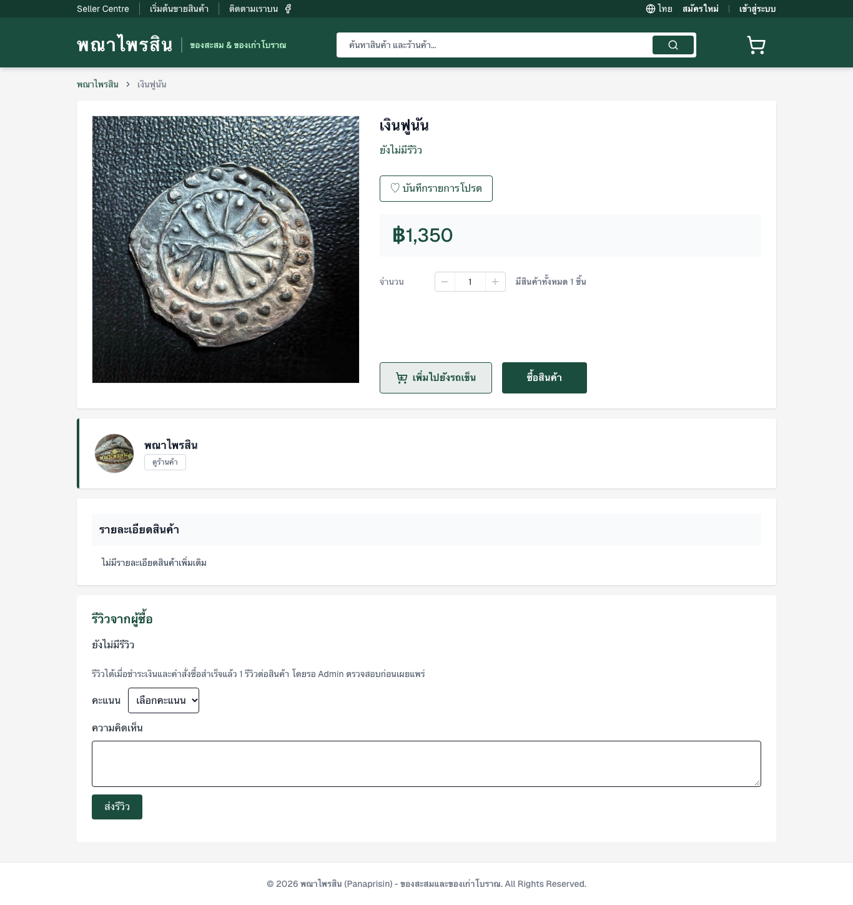
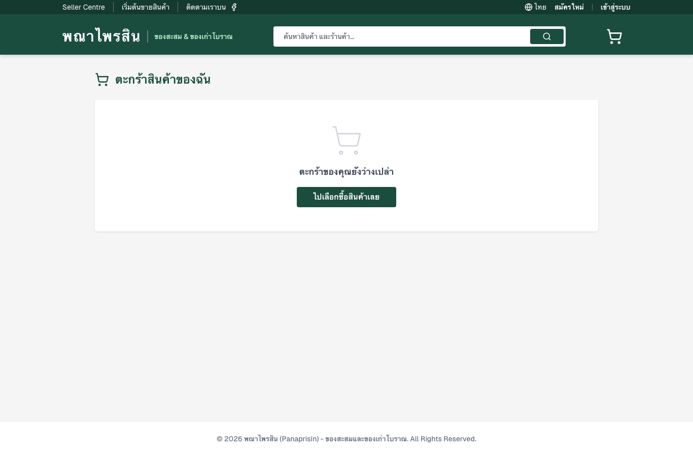
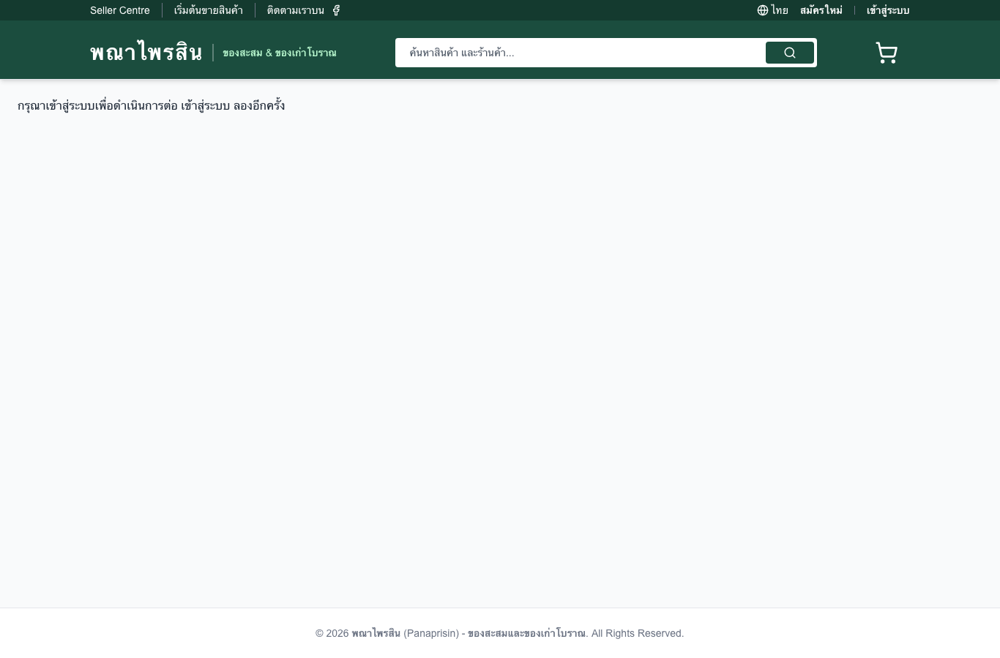

# คู่มือใช้งาน Buyer, Seller และ Admin

คู่มือนี้ยึดหน้าจอและ Controller ใน main. หน้าที่ต้องเข้าสู่ระบบยังต้องมีบัญชีทดสอบของบทบาทนั้นก่อนยืนยันการทำงานบน Production

## เริ่มใช้งาน

เปิดเว็บไซต์ เลือกสินค้าเพื่ออ่านรายละเอียดและรีวิว ใช้ `/signup` สมัครสมาชิกหรือ `/login` เข้าสู่ระบบ บัญชี Admin ไม่สามารถสร้างผ่านแบบฟอร์มสมัครทั่วไป Google Login ต้องมีการตั้งค่า provider และบัญชีที่ใช้งานได้

## Buyer

1. เลือกสินค้า ตรวจราคาและสต็อก แล้วเพิ่มลงตะกร้า เปิด `/cart` เพื่อปรับจำนวนหรือลบรายการ
2. เปิด `/checkout` กรอกข้อมูลจัดส่งและเลือกวิธีชำระเงิน ตรวจรายการก่อนยืนยัน
3. ระบบคำนวณราคาจากฐานข้อมูล ตรวจสต็อก สร้างคำสั่งซื้อ ตัดสต็อก และล้างตะกร้าใน transaction จากนั้นเปิดหน้ายืนยันที่อ้างอิงคำสั่งซื้อจริง
4. หากเครือข่ายไม่แน่นอน ให้ตรวจสอบคำขอเดิมตามหน้าจอ การส่ง idempotency key เดิมและข้อมูลเดิมคืนคำสั่งซื้อเดิม ไม่สร้างซ้ำ
5. เปิด `/account` ดูภาพรวม, `/account/orders` ดูรายการและรายละเอียด, `/account/profile` แก้ชื่อ โทรศัพท์ และที่อยู่ อีเมลแก้ผ่านฟอร์มนี้ไม่ได้
6. บันทึกสินค้าที่สนใจและเปิด `/wishlist`; รีวิวให้คะแนน 1–5 ได้เมื่อซื้อสินค้านั้นในคำสั่งซื้อ completed และชำระครบแล้ว รีวิวรอ Admin อนุมัติก่อนเผยแพร่ หนึ่งบัญชีรีวิวสินค้าหนึ่งรายการได้ครั้งเดียว
7. ออกจากระบบเมื่อใช้งานเสร็จ Token จะถูกเพิกถอน

## Seller

1. เข้าสู่ระบบ Seller เปิด `/seller` และ `/seller/products`
2. เปิด `/seller/add-product` ระบุชื่อ รายละเอียด หมวดหมู่ ราคา สต็อก และภาพสินค้า บันทึกแล้วตรวจรายการของร้าน
3. เลือกแก้ไขสินค้า; การลบเป็นการ archive ด้วย `is_active=false` เพื่อรักษาประวัติคำสั่งซื้อ
4. เปิด `/seller/orders` ดูเฉพาะรายการของร้านและเปลี่ยนหน้ารายการเมื่อมีหลายหน้า Seller ไม่มีสิทธิ์เปลี่ยนสถานะคำสั่งซื้อ
5. เปิด `/seller/reports` กรองช่วงวัน ยอดขายนับเฉพาะสินค้าของร้านที่มีการชำระครบ ไม่ใช่มูลค่าตะกร้าหรือคำสั่งซื้อ pending

## Admin

1. เปิด `/admin` ดูภาพรวม และ `/admin/users` จัดการผู้ใช้ เปลี่ยน role ได้เฉพาะ buyer/seller ที่ไม่มีประวัติซื้อขาย ห้ามเปลี่ยน role ตัวเองหรือ Admin; บัญชีมีประวัติธุรกรรมไม่สามารถลบได้
2. เปิด `/admin/products` จัดการสินค้า; ภาพสินค้าให้ใช้ Seller editor ตามความสามารถของหน้าจอ
3. เปิด `/admin/orders` ตรวจคำสั่งซื้อ ก่อนยืนยันเงินต้องตรวจรายการรับเงินจริงและกรอกเลขอ้างอิง ระบบบันทึกผู้ตรวจ เวลา และ reference
4. ลำดับสถานะคือ pending → paid → shipped → completed; paid ต้องผ่าน confirm-payment เท่านั้น pending ยกเลิกได้และคืนสต็อกครั้งเดียว รายการจ่ายแล้วต้องมีกระบวนการคืนเงินแยกซึ่งยังไม่มีในระบบ
5. เปิด `/admin/reviews` อนุมัติหรือปฏิเสธรีวิว โดยรีวิวที่อนุมัติต้องมีหลักฐานซื้อสำเร็จ
6. เปิด `/admin/reports` ดูยอดรวมทั้งระบบตามวันที่ชำระเงิน เขตเวลา Asia/Bangkok

## ข้อผิดพลาดและการแก้ไข

| สถานะ | การดำเนินการ |
|---|---|
| 401 | เข้าสู่ระบบใหม่ |
| 403 | ใช้บัญชีบทบาทที่ได้รับสิทธิ์ |
| 404 | ตรวจรายการและเจ้าของข้อมูล |
| 409 | ตรวจรายการซ้ำหรือข้อขัดแย้งของธุรกรรมก่อนส่งใหม่ |
| 422 | แก้ช่องกรอก จำนวนสินค้า หรือสถานะตามข้อความ |
| เครือข่ายขัดข้อง | Retry และตรวจคำสั่งซื้อเดิมก่อนทำรายการซ้ำ |

อ้างอิง [เส้นทาง API](../backend/routes/api.php) และ [หน้าจอ](../frontend/src/app)

## ภาพประกอบจากเว็บไซต์จริง

ภาพชุดนี้เป็นการเปิดเว็บแบบผู้เยี่ยมชม วันที่ 1 พฤศจิกายน 2026 ไม่ใช่หลักฐานการทำธุรกรรมสำเร็จ

เมื่อ Checkout ตอบ validation 422 ให้แก้ข้อมูลก่อนส่งใหม่; กรณีผลเครือข่ายไม่แน่นอน หน้าเว็บเก็บคำขอเดิมใน sessionStorage เพื่อช่วยตรวจสอบรายการเดิม การแก้สินค้าแบบ multipart รองรับ method override PATCH ที่ API

## ขอบเขตการใช้งานเพิ่มเติม

Wishlist ยังไม่มีการแบ่งหน้า รีวิวจำกัดข้อความ 3,000 ตัวอักษร และไม่มีขั้นตอนแก้รีวิว แนบภาพ หรือตอบกลับใน API ปัจจุบัน การ retry Checkout ผ่าน sessionStorage จำกัดอยู่ใน Browser/แท็บนั้น; การสร้าง key ใหม่ไม่ใช่การตรวจจับคำสั่งซื้อซ้ำทางธุรกิจ
